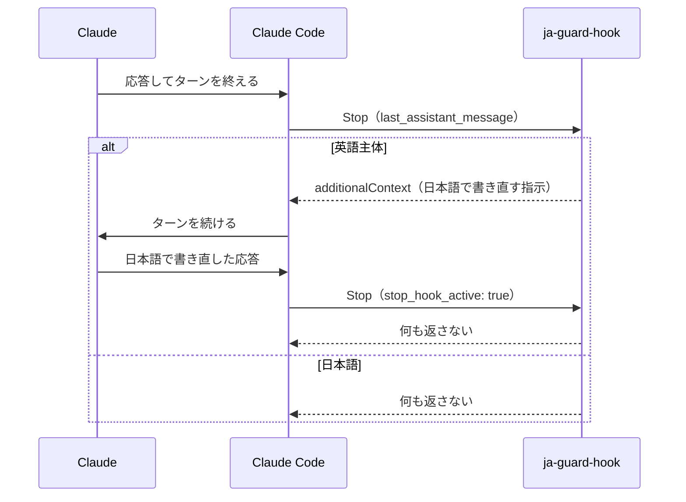

# ja-guard-hook

[](https://github.com/tsuka00/ja-guard-hook/actions/workflows/ci.yml)
[](LICENSE)

Claude Code の応答が英語に切り替わったとき、ターンの終わりに検出して日本語で書き直させる [Stop hook](https://code.claude.com/docs/en/hooks#stop) です。

CLAUDE.md で日本語での応答を指示していても、長い作業の後や英語のツール出力を読んだ直後に、応答が英語になることがあります。ja-guard-hook は応答を機械的に検査し、英語主体なら Claude に書き直しを求めます。

## 仕組み



- 検査するのは、Stop hook の入力に含まれる最終応答（`last_assistant_message`）です
- 差し戻しには `additionalContext` を使います。`decision: "block"` と違い、hook error として表示されません
- 書き直した後のターン（`stop_hook_active` が `true`）では検査しません。書き直しが再び英語でも、差し戻しは1ターンに1回までです

## 動作要件

- Claude Code v2.1.163 以上（Stop hook の `additionalContext` に対応したバージョン）
- Python 3.9 以上（標準ライブラリだけで動きます。macOS 標準の `python3` で動作します）

## 導入

1. リポジトリを `~/.claude/hooks/` に clone します。

   ```bash
   git clone https://github.com/tsuka00/ja-guard-hook.git ~/.claude/hooks/ja-guard-hook
   ```

2. `~/.claude/settings.json` の `hooks.Stop` に次の1件を追加します。既存の設定は残したまま、`hooks` や `Stop` が無ければ作ってください。

   ```json
   {
     "hooks": {
       "Stop": [
         {
           "hooks": [
             {
               "type": "command",
               "command": "python3 \"$HOME/.claude/hooks/ja-guard-hook/main.py\""
             }
           ]
         }
       ]
     }
   }
   ```

3. 動作を確認します。英語の応答を渡すと `additionalContext` を含む JSON が出力され、日本語の応答を渡すと何も出力されません。

   ```bash
   echo '{"hook_event_name":"Stop","stop_hook_active":false,"last_assistant_message":"I have finished the refactoring and all tests pass now."}' \
     | python3 ~/.claude/hooks/ja-guard-hook/main.py
   ```

設定は新しく開いたセッションから読み込まれます。

### 更新・削除

```bash
# 更新
git -C ~/.claude/hooks/ja-guard-hook pull

# 削除（settings.json に追加した1件も消してください）
rm -rf ~/.claude/hooks/ja-guard-hook
```

## 判定のルール

コードブロックとインラインコードを除いた本文で、英語の語の数が 5 以上あり、かつ日本語の文字数の 3 倍を超える応答を英語主体とみなします。

- **英語の語**：空白で区切った語のうち、英字を含み ASCII だけでできたもの。`detector.py` や `https://example.com` も1語と数えます
- **日本語の文字**：平仮名・片仮名（半角を含む）・漢字・々〆〇 と長音符。句読点や括弧などの記号は数えません

英語になった応答は丸ごと英語になり、日本語の応答では英語の語が日本語の文字数を大きく下回ります。そのため、応答全体での単純な比較で両者を分けられます。サービス名やファイル名が英語でも、会話が日本語なら差し戻しません。

### 閾値の変更

環境変数で閾値を変えられます。不正な値（数値でない・0 以下など）は既定値として扱います。

| 環境変数 | 既定値 | 意味 |
| --- | --- | --- |
| `JA_GUARD_MIN_WORDS` | `5` | 英語の語がこの数未満の応答は判定しない（短い返事を差し戻さないため） |
| `JA_GUARD_RATIO` | `3` | 英語の語の数が日本語の文字数のこの倍を超えたら英語主体とみなす |

## 制約

- ツール呼び出しの間に出る途中経過の文章は検査しません（最終応答だけが対象です）
- 英語での応答を明示的に頼んだ場合も、日本語に書き直されます。英文が必要なときはコードブロックで出すよう頼んでください
- サブエージェントの応答（`SubagentStop`）は対象外です
- ほかの Stop hook がターンを続けさせた後の応答は検査しません。Claude Code は、どの Stop hook が続けさせた場合も `stop_hook_active` を `true` にするため、自分の差し戻しと区別できないからです

## 開発

[uv](https://docs.astral.sh/uv/) を使います。

```bash
uv sync                          # 開発用の依存を入れる
uv run pytest                    # テスト
uv run ruff check                # lint
uv run ruff format --check       # フォーマットの確認
uv run mypy                      # 型検査
```

| パス | 役割 |
| --- | --- |
| `main.py` | エントリーポイント |
| `ja_guard/hook.py` | Stop hook の入出力（標準入出力・環境変数はここだけが扱う） |
| `ja_guard/detector.py` | 英語主体かの判定（純関数） |
| `ja_guard/config.py` | 環境変数から閾値を読む |
| `docs/decisions/` | 設計判断の記録（ADR） |

## ライセンス

[MIT](LICENSE)
